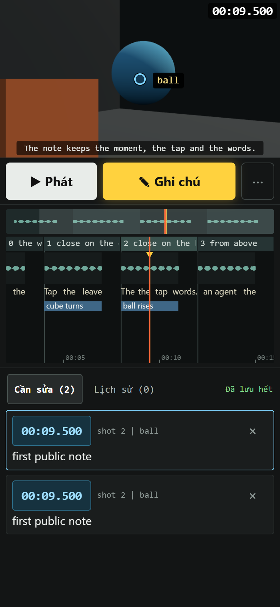

# Live Studio

Watch a Three.js film live in the browser and leave feedback on it, from a PC or a phone. An AI agent reads the feedback and makes the changes.

The creator only watches, taps and talks. Nothing in the studio can edit the film, so a stray thumb can't break the pacing.



## Run the demo

Needs Node 20+ and Python 3 (for the small helper scripts). ffmpeg is needed for audio on anything but the machine running it.

```bash
npm install
npm run demo -- 4321
```

Open http://localhost:4321. The interface text is in Vietnamese for now: **Phát** is play, **Ghi chú** is note.

The server listens on this machine only and has no password. To use a phone, put it behind something private such as `tailscale serve`, never on the open internet.

## Taking notes

- Press the note button, or tap the picture to pin the exact thing you mean. Type or dictate.
- Tap an old note to edit it in the same box, with a warning before it overwrites. Tap its time to jump there.
- The list follows the film, keeping the note nearest the playhead in view.
- Fixed notes move to the History tab with what was done. One press sends them back.

Words aren't lost: every keystroke is kept on the device, unsent notes wait and retry when the signal drops, the file is written atomically, × moves a note to `notes/deleted.jsonl` with an undo, and copies pile up in `renders/notes_backup`.

## Before and after

Every change to the film is kept as a version in `renders/versions`, 30 at most. Press **So sánh** (B) to draw an older version beside the current one, frame for frame.

- "Before" is the version you last watched: using the page counts as watching, opening it doesn't. The list next to the bar picks any other.
- Pink marks on the timeline are where the picture changed, yellow where the sound did. Z and X jump between them, and boxes show the place in the frame. A change over more than half the frame gets no box, since it's the camera or the light.
- **Bật qua lại** (V) flips between the two. On a small screen only one fits, so it's before or after.
- The tab **Thay đổi** lists each change in words, from `edit.json`.

Both versions are drawn at the same second of the voice, so re-pacing the voice marks only what really moved against it, not everything after it. The picture check runs in a headless Chrome (`tools/chrome-headless-shell`, `LIVE_CHROME`, or the system's), saves as it goes, and carries on after a restart.

An old version shows today's asset files, so changed models or textures are listed with a warning rather than compared.

## What the agent gets

Each note in `notes/notes.jsonl` carries the time and frame, the tap position and the object under it, the 3D point, the camera, the shot and how far into it, the words and actions around the moment, whether the film was playing when the note was pressed, the device, and the version of the film. Three pictures go with it: the frame with the pin, the area under the tap, and a strip of the seconds around the moment.

An agent shouldn't read that file raw:

```bash
python notes_report.py             # index by shot, one line per note
python notes_report.py ID ID       # everything about those notes, and the pictures to open
python notes_report.py --shot 3    # everything about one shot's notes
```

## Use it on your own film

There is one studio: this repo. A film never holds a copy, so a fix made here reaches every film the next time its studio starts.

```bash
git clone https://github.com/Gohans1/live-studio ../live-studio   # beside the film
npm install --prefix ../live-studio
node ../live-studio/init.mjs .          # connect this project, --dry to only see what it would do
node src/live.mjs 4321
```

`init.mjs` adds a `file:` dependency, so `node_modules/live-studio` is a link to this repo, and writes three small files into the film: `src/live.mjs` and `notes_report.py` open the studio on this film, and `src/edit.ts` hands `edit.json` to it. It refuses if a file about to be removed holds changes this repo never had, so they can be moved here first. A project with no film yet gets the demo's parts to replace.

The film owns everything else: `src/scene.ts`, `src/edit.json`, `src/timing.ts`, `voice_map.py`, `voice_edit.py`, `sound.py`, `make_lite.py`, `assets/`. The `demo/` folder is the example of all of them. The studio finds them through two names when it bundles: `film/...` is the film's `src/`, `live-studio/edit` is `src/edit.ts` here.

Every film runs the same studio, so a change here affects them all. Saving a page file reloads the open pages; a change to `src/live.mjs` or `src/versions.mjs` needs each studio restarted.

Replace `src/scene.ts`. It exports `SHOTS`, `SHOTS_OUT`, `DURATION`, `applyEdit` and `buildScene(canvas, W, H, draft)`, which returns `draw(t)` with `draw.tools` attached. The demo scene shows the whole contract in about 80 lines, and `draw(t)` must be able to draw any moment straight away.

All timing lives in `src/edit.json`, in the voice's original seconds, so that actions follow the words when the voice is re-paced. Replace these with your own:

| File | Job |
| --- | --- |
| `assets/public/agent/full_voice.wav` | The voice |
| `voice_map.py` | Word times and waveform for the timeline |
| `sound.py` | The sound mix |
| `voice_edit.py` | Applying voice edits from `edit.json` (a stub here) |
| `make_lite.py` | Small asset copies for phones (empty here) |

## License

MIT. The demo uses [three.js](https://threejs.org) and [esbuild](https://esbuild.github.io), both MIT.
